# Hi, I'm Mariangel 👋

  

---

### 🙋‍♀️ About Me :

🧪 **QA Analyst**  
💻 **TypeScript, Playwright, SQL & Postman**  
🎯 **Focused on E2E testing, web automation & QA best practices**  

* 👀 I’m interested in continuous learning and growing as a QA professional.
* 🌱 I’m currently improving my skills in automated testing frameworks.
* 📫 How to reach me: [LinkedIn Profile](https://www.linkedin.com/in/mariangel-ruiz-35b3a035b/)

---

### 🛠️ Tech Stack & Tools

